# Devout Shen

A fan-made League of Legends skin mod by **KamAI Industries**: Shen reimagined as a devout warrior-monk. He keeps base Shen's silhouette, now in a deep purple hood and quilted gi with silver crosses, a gold crucifix-hilted sabre, a rosary and a flowing cape. Every ability carries the theme, from a Trinity-cross Spirit Blade to a kneeling prayer beneath the face of Christ.

**Download:** on RuneForge (search for **Devout Shen**).

The images and clips below are rendered from the mod's own files.

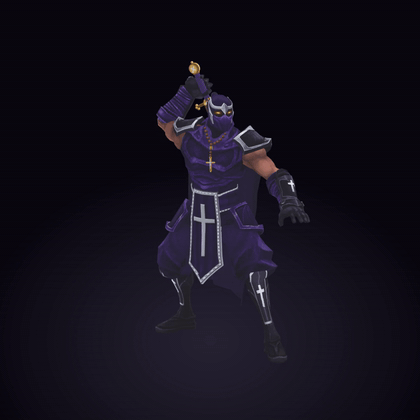

[Turntable video](media/videos/turntable.mp4?raw=true)

## Loading screen

A new loading-screen card, "Dominus Vobiscum", so you can tell the mod is active before the game starts.

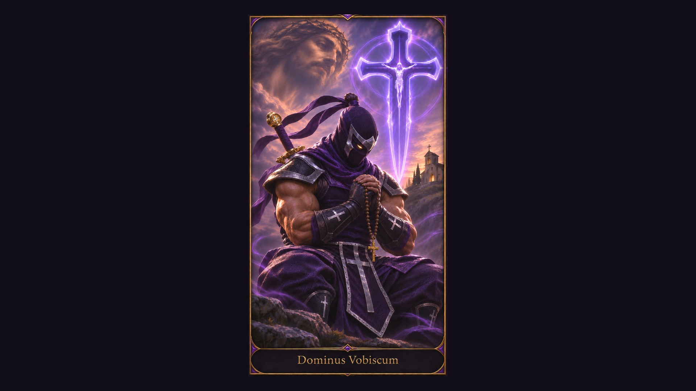

## The look

A deep purple hood and mask with only his glowing golden eyes showing, framed by a silver brow band, a folded silver diamond and blades down each cheek. A topknot with two flowing silk tails. A quilted gi with slimmed, silver-rimmed pauldrons, bracers and greaves, and plain silver crosses on his tabard, bracers and greaves.

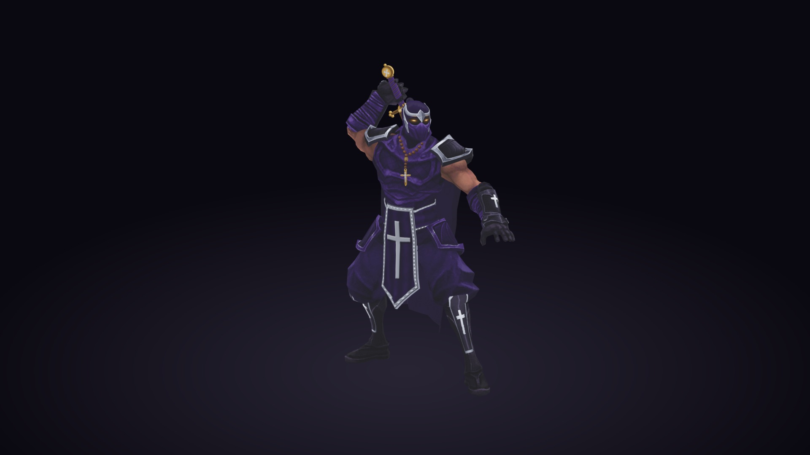

On his back, a free-flowing purple cape that hangs from under his pauldrons, shoulder to shoulder, with a quiet fleur-de-lis damask and a silver cross, under a gold crucifix-hilted sabre in a purple scabbard inscribed DEUS VULT. A rosary hangs at his chest, simulated as he moves.

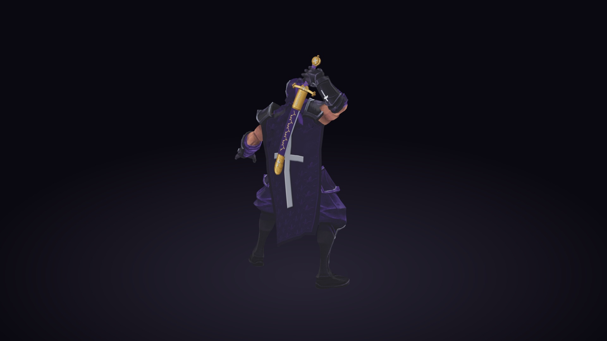

## Abilities

New stained-glass ability icons.

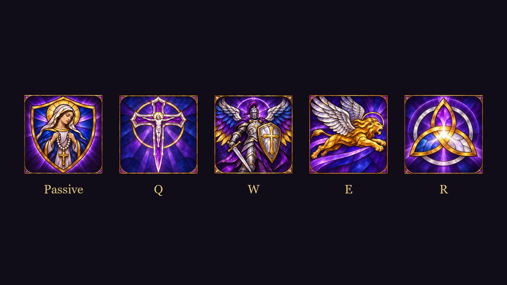

### Passive: the Trinity cross

His Spirit Blade is a violet Trinity cross reading THE FATHER, THE HOLY SPIRIT and THE SON.

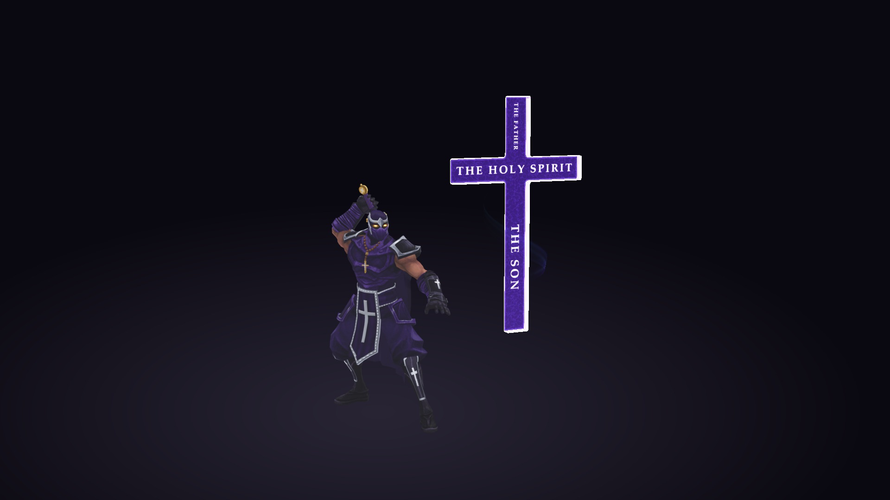

### Q: the Holy Cross greatsword

While Q lasts he carries the Holy Cross greatsword. When empowered it turns to holy golden light, with glints along the blade and motes of light drifting up from it.

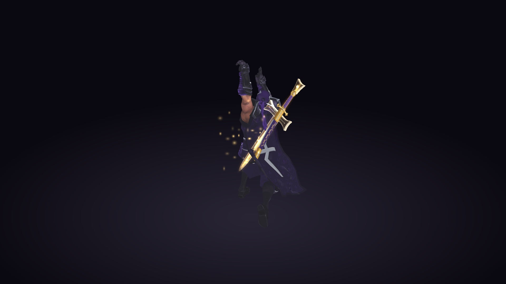

### W: Spirit's Refuge

The refuge ring in holy gold, with royal purple inside.

### E: Shadow Dash

A lion's roar as he dashes.

### R: Stand United

He kneels in prayer facing you. The face of Christ shines above him in a glory of rays as a beam of holy light comes down on him, and a sanctified circle of light lies around him. His shout becomes a Latin prayer: *"In nomine Christi te protego"* (In the name of Christ I protect you).

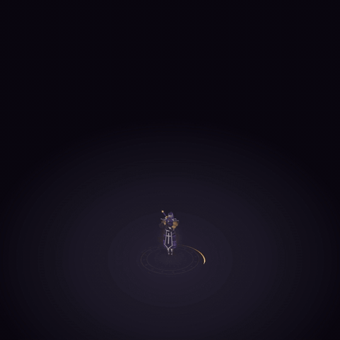

[Watch the ult (with sound)](media/videos/ult.mp4?raw=true)

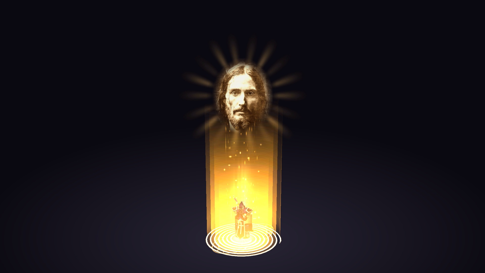

His ally gets a divine shield: a golden bubble, a halo bearing the Trinity knot and drifting white feathers.

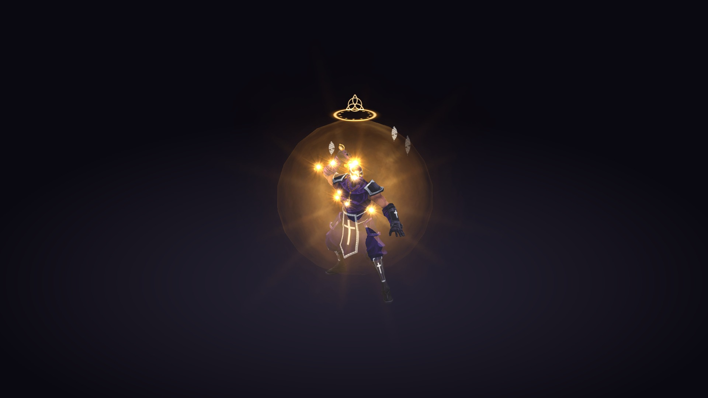

## Dance (Ctrl+3)

He goes down on one knee and bows his head, his fist on his heart, under softly dancing holy light, to sacred choral music that loops for as long as he kneels.

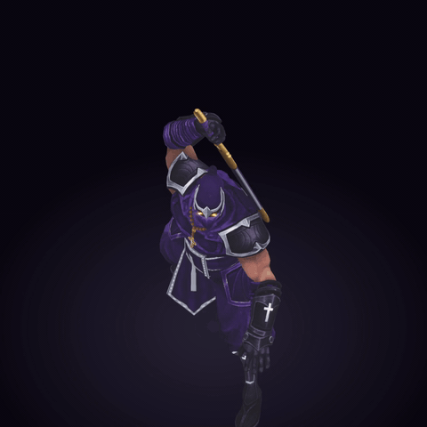

[Watch the dance (with sound)](media/videos/dance.mp4?raw=true)

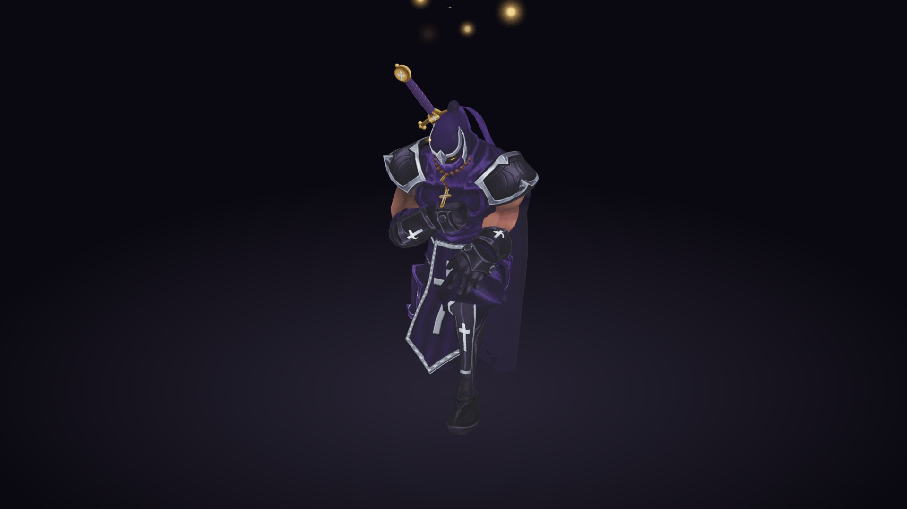

## Recall

He turns to you and makes the sign of the cross, his hand leaving a cross of light on his chest as a ring of light runs out from his feet. Then he raises the radiant Holy Cross greatsword to the sky and a shaft of holy light comes down on its point, growing brighter until he is gone, to a Gregorian prayer.

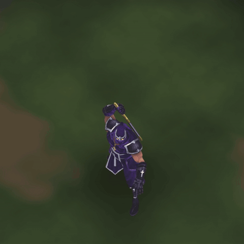

[Watch the recall (with sound)](media/videos/recall.mp4?raw=true)

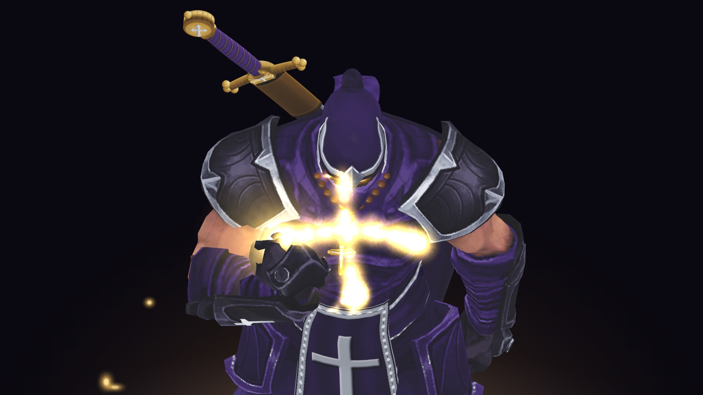

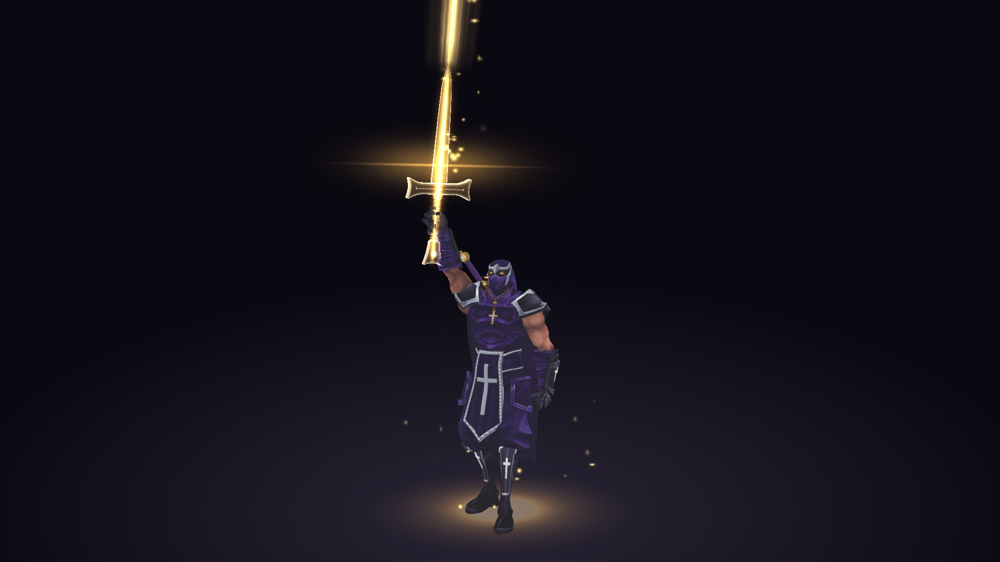

## What's new in 1.1.0

- **The cape** now hangs from under his pauldrons, as wide as his shoulders, and its silver cross stays one clean cross as the cloth folds.
- **The recall** opens with the sign of the cross drawn in light, and its light now sits exactly on the raised blade.
- **The ult:** the face of Christ stays fixed over him wherever he stands on screen.

## How to use

Import the `.fantome` into LTK Manager, enable it, and play Shen with his default (classic) skin. It's cosmetic only and changes nothing about gameplay. The Latin ult line replaces his English shout; on other game languages his own shout still plays alongside it.

## Credits

- Mod by **KamAI Industries**. The Latin ult voice line is KamAI Industries' own recording.
- Dance music: "Cathedral" by Music_For_Videos (Pixabay, Pixabay Content License).
- Recall prayer: "Gregorian Chant - Private Prayer to Mary" by NickPanek (Pixabay, Pixabay Content License).
- Lion roar on E: "Lion roaring" by Bidone (Freesound 69572, CC0).
- The face of Christ in the ult is made from a reference picture; it isn't KamAI Industries' work and the licence below doesn't cover it.
- League of Legends and Shen are Riot Games'. This is an unofficial fan mod, not endorsed by Riot Games.

## Licence

The mod's own work is licensed under [CC BY-NC 4.0](https://creativecommons.org/licenses/by-nc/4.0/). See [LICENSE](LICENSE) for what it does and doesn't cover.
